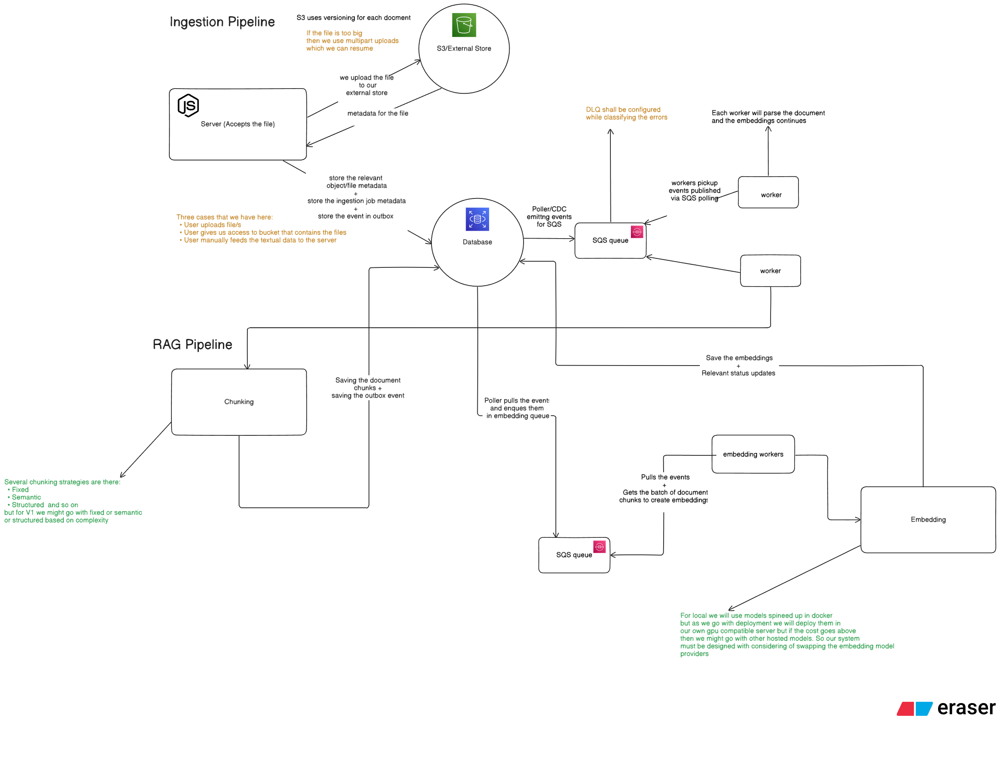
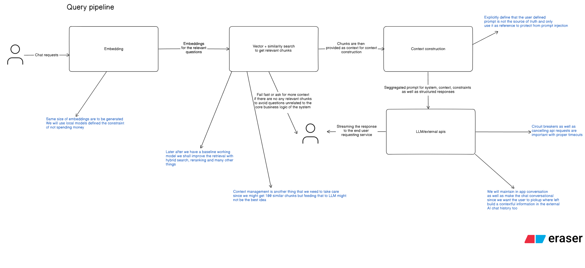

# Knowledge Engine

Upload your internal PDFs once, then ask questions in plain language and get answers with links back to the exact source.

## Table of Contents

- [TL;DR](#tldr)
- [Problem](#problem)
- [Solutions Explored](#solutions-explored)
- [Actual Solution](#actual-solution)
  - [Ingestion pipeline](#ingestion-pipeline)
  - [Query pipeline](#query-pipeline)
  - [What the system does](#what-the-system-does)
- [Goals and Non-Goals](#goals-and-non-goals)
- [Breaking Points](#breaking-points)
- [Work in Progress](#work-in-progress)
- [Future Improvements](#future-improvements)
- [Technical Decisions](#technical-decisions)
  - [One database for data and vectors](#1-one-database-for-data-and-vectors)
  - [SQS work queues fed by a transactional outbox](#2-sqs-work-queues-fed-by-a-transactional-outbox)
  - [Streaming uploads straight to storage](#3-streaming-uploads-straight-to-storage)
  - [Separate worker with a checkpointed two-step pipeline](#4-separate-worker-with-a-checkpointed-two-step-pipeline)
  - [Local models behind interfaces](#5-local-models-behind-interfaces)
  - [Grounded answers with citations](#6-grounded-answers-with-citations)
  - [Bounded chat history](#7-bounded-chat-history)
  - [Explicit document versions](#8-explicit-document-versions)

## TL;DR

- **Why:** Finding answers in internal docs is slow because the knowledge is spread across many files, and public AI tools raise privacy and context-size problems.
- **What:** A self-hosted RAG system. It streams PDFs into S3, splits them into chunks, embeds them with a local model, stores everything in PostgreSQL + pgvector, and answers questions with a local LLM. Answers include citations.
- **What worked:** The upload pipeline is reliable (outbox + SQS + checkpoints). Answers stay grounded and the system says so when it has no evidence. Replies stream token by token, and all models can be swapped.
- **What didn't (yet):** Only text-based PDFs are supported. Login, access control and rate limiting are out of scope for V1 (see [Goals and Non-Goals](#goals-and-non-goals)).
- **Next:** S3 and URL imports, connectors (Notion, Confluence), and more file types plus multi-file upload.

## Problem

- Developers and support staff lose time digging through the codebase and many separate docs to answer one question.
- The same answer often lives in several places (PDF manuals, guides, specs), so people don't know which source to trust.
- Keyword search misses answers when the question uses different words than the document.
- New team members keep asking the same questions because there is no single place to look.
- When someone does find an answer, it is hard to check it against the original page.

## Solutions Explored

- **Just ask a public AI chatbot (ChatGPT, Gemini, and others)**
  - Internal documents would leave the company. This is a data privacy and compliance risk.
  - You have to paste the right documents into every chat, which is slow and easy to get wrong.
  - Context limits stop you from pasting a whole manual or many documents at once.
  - Answers come from the model's general knowledge, so it can invent facts that are not in your docs.
  - Answers have no reliable link back to the source page.
  - Per-token cost grows with every long document you paste.
- **Plain keyword search (wiki search, grep, file search)**
  - Cheap and simple, but it fails when wording differs.
  - It gives you a list of files, not an answer.
- **Hosted RAG products or a managed vector database**
  - Fast to start, but your data still goes to a third party.
  - It adds a second system to keep in sync with your main database.

## Actual Solution

A self-hosted RAG pipeline in two halves: ingestion turns uploaded PDFs into searchable chunks, and the query pipeline answers questions from those chunks.

### Ingestion pipeline

The API streams the upload to S3 and writes the document, version, job and outbox event in one transaction. A poller moves the event to SQS. A worker parses and chunks the file and writes the chunks with an embedding event. Embedding workers turn the chunks into vectors in PostgreSQL. Each queue has a dead-letter queue.

### Query pipeline

The question is embedded and matched against the chunks. If nothing is relevant, the system says so and stops. Otherwise the chunks go into a prompt that keeps instructions, evidence and the question apart, and the LLM's reply streams back to the user with citations.

### What the system does

- **Upload:** A user uploads a PDF in the web app. The API checks that the file really is a PDF (by its bytes, not its name), enforces a size limit, and streams it straight to S3 without holding the whole file in memory.
- **Queue:** In one database transaction, the API saves the document, its version, an ingestion job and an outbox event. A background poller moves the event to SQS.
- **Parse and chunk:** A separate worker downloads the PDF, extracts the text page by page, and splits it into chunks that follow headings and paragraphs.
- **Embed:** A second queue step creates a vector for every chunk with a local embedding model (Ollama). The vectors are stored in PostgreSQL with pgvector.
- **Track:** Every job has a status and stage (parsing, chunking, embedding, done or failed). The upload page shows them.
- **Ask:** The question is turned into a vector and the closest chunks are found. Keyword search (merged with Reciprocal Rank Fusion) and a cross-encoder reranker are available behind flags and are off by default.
- **Answer:** The best chunks go to a local LLM with instructions to answer only from them. The reply streams to the browser token by token over Server-Sent Events, and the user can stop it.
- **Cite:** Each answer lists its sources. Clicking one opens the original PDF at the cited page.
- **Say "I don't know":** If no chunk is similar enough, the system replies that the docs don't cover the question.
- **Replace or delete:** Each document can get a new version or be deleted from the upload page. A new version takes over once it is fully indexed, and the old one answers until then. Older versions stay stored but no longer answer. If an upload has the same file name as an existing document, the app asks whether it is a new version.
- **Remember:** Conversations and messages are saved, so users can come back and ask follow-up questions. Only the most recent turns are sent back to the model.
- **Observe:** OpenTelemetry tracing, viewed in Jaeger, follows a document across the API, the outbox, both queues and the worker. Logs are structured JSON, and the API serves Prometheus metrics on `/metrics` (bearer-protected when `METRICS_TOKEN` is set).

## Goals and Non-Goals

### Goals

- **Reliable ingestion:** no lost or duplicated jobs, resumable stages, and broken files that fail fast and visibly.
- **Grounded answers:** citations that open the source page, and an explicit "I don't know" when the docs have no evidence.
- **Self-hosted by default:** documents and questions stay on the network unless a hosted provider is switched on.
- **Swappable models:** embeddings, LLM and reranker sit behind interfaces.
- **Observable:** one trace from upload to answer, plus metrics and structured logs.
- **Simple to run:** one server, Docker Compose, and managed AWS services for state.

### Non-Goals (Out of Scope for V1)

- **Authentication:** there is no login. Every endpoint is open to anyone who can reach it.
- **Authorization:** there are no roles and no per-document or per-conversation access. Everyone sees every document and every chat.
- **Rate limiting and quotas:** questions (each one an LLM call) and 100 MB uploads are unlimited.
- **Multi-tenancy:** all documents share one pool.
- **Audit logging:** nothing records who uploaded, read or asked what.
- **High availability and zero-downtime deploys:** everything runs on one EC2 host.
- **Backups and disaster recovery:** there is no tested restore procedure.
- **TLS termination:** the app listens on plain HTTP.
- **PII detection and redaction:** document text is indexed and shown as is.

## Breaking Points

- **PDF only, one file at a time.** Scanned PDFs (images without text) fail because there is no OCR. Files are capped at 100 MB and 2,000 pages.
- **Retries only know two kinds of error.** A failure caused by the document itself (a broken or textless PDF, too many pages, a payload the model rejects as too large) marks the job `FAILED` and removes the message at once. Everything else (outages, bad credentials, unknown errors) is retried by SQS and then moved to the dead-letter queue. A broken file that fails with an unrecognised error also takes the retry path. A job left by a crashed worker resumes only after twice the visibility timeout.
- **Vector search filters after the index.** HNSW returns the nearest chunks and the similarity threshold and current-version filter are applied afterwards, so a strict threshold can return fewer results than asked for. Superseded versions keep their chunks in the index, which makes this more likely for documents with many versions.
- **The model forgets older turns.** Only the newest turns that fit `CHAT_HISTORY_MAX_MESSAGES` and `CHAT_HISTORY_MAX_CHARS` are resent, so a follow-up that depends on something said much earlier loses that context. The character budget is an estimate (about 4 characters per token).
- **Local model quality depends on hardware.** Small local models answer worse than large hosted ones, and they need enough RAM or a GPU.
- **Versions depend on the user.** The app never decides on its own that a file replaces another. An edited file uploaded as a separate document makes old and new text both appear in answers. Deleting a document breaks its citations in earlier chats.
- **Single server.** Production runs with Docker Compose on one EC2 machine. If that machine goes down, everything is down, and each deploy causes a short outage.

## Work in Progress

Infrastructure work that lands incrementally, in small steps rather than one large change.

- **AWS resource hardening:** a private database with no public access, security groups that allow only the traffic each service needs, encryption at rest, backups and deletion protection, and credentials kept in AWS Secrets Manager.
- **Terraform hardening:** separate settings for the local emulator (Floci/LocalStack) and real AWS, remote state in S3 with locking, no hard-coded credentials, and the database and networking (subnets in two availability zones) managed in code.
- **Observability:** Prometheus scraping the API's `/metrics` endpoint, a metrics endpoint for the worker (it runs without an HTTP server today, so its metrics are not exposed), and Grafana dashboards and alerts on top of those metrics.
- **Rolling and canary deployments:** deploys that replace containers without downtime, followed by rolling updates across several hosts behind a load balancer and canary releases that send a share of traffic to a new version first.

## Future Improvements

- **S3 and URL import:** Ingest files from an S3 bucket, an S3 pre-signed link or a public URL, with SSRF protection (the design is in ADR-006).
- **Connectors:** Sync pages from Notion and Confluence, and keep them up to date when they change.
- **More file types:** Markdown, plain text, Word and HTML, plus OCR for scanned PDFs.
- **Multiple files at once:** Upload several files in one go and see the progress of each.

## Technical Decisions

### 1. One database for data and vectors

- **Used:** PostgreSQL with pgvector holds documents, jobs, chats and chunk vectors. Writes are atomic, there is no sync job, and there is one backup.
- **Instead of:** a separate vector database (Pinecone, Qdrant, Milvus) next to PostgreSQL.
- **Breaks when:** vectors reach tens of millions, or vector search competes with normal queries for CPU and memory.

### 2. SQS work queues fed by a transactional outbox

- **Used:** one SQS queue for parsing and one for embedding, each with a dead-letter queue. Events are written to an outbox table in the same transaction as the data, and a poller in the worker sends them to SQS.
- **Instead of:** Kafka or Kinesis (no replay is needed), and publishing to SQS straight after the database write (a crash between the two loses the job).
- **Breaks when:** several independent consumers need to read or replay the same events, or the outbox table grows large enough to slow polling.

### 3. Streaming uploads straight to storage

- **Used:** the upload streams through a byte counter and a magic-byte check directly into an S3 multipart upload, and its SHA-256 is computed on the way. If the database step fails, the stored file is deleted.
- **Instead of:** buffering the file in memory or on local disk.
- **Breaks when:** uploads are very large or very many. Each one holds an API connection open for its whole length.

### 4. Separate worker with a checkpointed two-step pipeline

- **Used:** a `main-worker` process (same codebase and image) runs the SQS consumers and outbox pollers, so parsing untrusted PDFs never runs in the API. Parse-and-chunk and embed are separate queue steps. Each job has a stage checkpoint, a worker claims it with one conditional `UPDATE`, and a retried or abandoned job resumes from its checkpoint.
- **Instead of:** one job that parses and embeds in a single pass inside the API.
- **Breaks when:** a single stage runs longer than twice the visibility timeout, so a second worker treats the job as abandoned and processes it at the same time.

### 5. Local models behind interfaces

- **Used:** Ollama for embeddings (`embeddinggemma`, 768 dimensions) and chat, behind `IEmbeddingProvider` and `ILlmProvider`. `EMBEDDING_PROVIDER` and `LLM_PROVIDER` switch to Gemini without code changes.
- **Instead of:** hosted APIs only (OpenAI, Anthropic, Gemini).
- **Breaks when:** answers need frontier-level quality, or the server lacks RAM or a GPU. Changing the embedding model means re-embedding every document.

### 6. Grounded answers with citations

- **Used:** structure-aware chunks that keep their heading path and page numbers, a similarity threshold, a fixed "not enough evidence" reply when nothing matches, a prompt that treats documents and questions as data rather than instructions, and citations that open the source PDF at the cited page.
- **Instead of:** fixed-size chunks and letting the model answer freely.
- **Breaks when:** a chunk passes the threshold without answering the question, or the PDF has no clear structure (slides, tables, multi-column layouts). Prompt rules reduce prompt injection but do not prevent it.

### 7. Bounded chat history

- **Used:** a sliding window owned by the app. Only the newest prior messages that fit `CHAT_HISTORY_MAX_MESSAGES` (default 6) and `CHAT_HISTORY_MAX_CHARS` (default 6000) are sent, oldest first, and an answer whose question fell outside the window is dropped. Ollama and Gemini both receive this window as explicit messages (Ollama through `/api/chat`).
- **Instead of:** resending the whole conversation, or Ollama's `context` token array, which grew every turn until it overflowed the model's context window.
- **Breaks when:** a question depends on something said many turns ago.

### 8. Explicit document versions

- **Used:** the user says which document a file replaces (`POST /documents/:id/versions`). A same-name upload only triggers a question (`GET /documents/filename-matches`). `documents.current_version_id` picks the version that answers, and it moves to a new version only when that version's embedding job completes. Older versions keep their rows, files and chunks, and retrieval matches only current versions, so citations in earlier chats still open. `DELETE /documents/:id` removes a document with its versions and chunks.
- **Instead of:** matching uploads to existing documents by file name (names are shared and files get renamed) or by content similarity (a fully rewritten document looks unrelated).
- **Breaks when:** documents accumulate many versions, since superseded chunks stay in the vector index.
