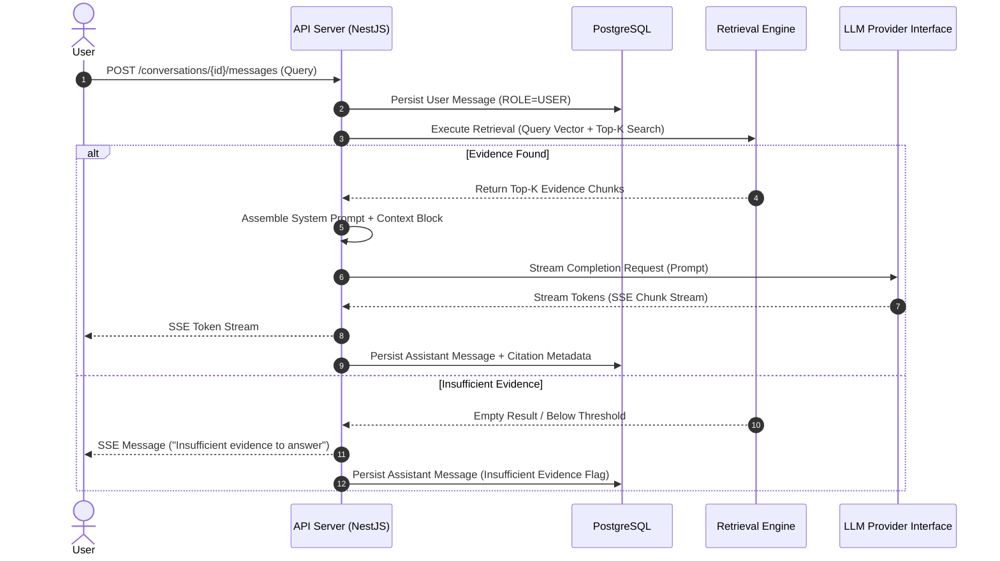

# Architecture: Chat Engine

## Purpose

The Chat Engine manages conversational sessions, orchestrates retrieval-before-generation, formats context prompts, streams AI responses, and formats inline citations.

---

## Conversation Lifecycle & Data Flow



---

## Retrieval-Before-Generation Protocol

Generative completion is strictly gated by the retrieval step:

1. **User Message Recording**: The incoming user query is saved to the database under the active `Conversation`.
2. **Context Retrieval**: The Retrieval Engine executes vector search against `pgvector`.
3. **Evidence Evaluation**:
   - **Sufficient Evidence**: The System Prompt incorporates retrieved passage texts along with source document metadata.
   - **Insufficient Evidence**: Generative completion is aborted; a pre-defined fallback message is returned directly to the client.

---

## System Prompt Structure

When evidence is retrieved, the LLM Provider is invoked with a structured prompt:

```text
SYSTEM PROMPT:
You are Knowledge Engine, an internal AI assistant. Answer the user's question using ONLY the provided document evidence below.

INSTRUCTIONS:
1. Do not use outside knowledge.
2. If the provided evidence is insufficient, explicitly state that you cannot answer.
3. Include inline citations matching source tags like [Source: Document Name, Chunk X].

CONTEXT EVIDENCE:
[Source: Security Policy, Chunk 2]: Credentials must be managed via AWS Secrets Manager.
[Source: Architecture Spec, Chunk 5]: AWS RDS PostgreSQL serves as the relational source of truth.

USER QUERY:
How should database credentials be stored?
```

---

## LLM Abstraction Boundary

Application code consumes a vendor-agnostic interface (`ILlmProvider`):

```typescript
export interface LlmStreamChunk {
  token: string;
  isComplete: boolean;
}

export interface ILlmProvider {
  generateStream(
    prompt: string,
    history: MessageHistory[]
  ): AsyncIterable<LlmStreamChunk>;
}
```

This abstraction isolates NestJS application code from vendor specifics (Ollama, local transformers, OpenAI, Anthropic), allowing model replacement via configuration.

---

## Response Streaming & Citation Persistence

- **Server-Sent Events (SSE)**: Responses are streamed back to the client token-by-token for minimal time-to-first-token (TTFT).
- **Post-Stream Persistence**: Once token streaming completes, the API Server commits the complete `Assistant` message and associated chunk reference IDs to PostgreSQL.

---

## Related Documentation

- [[overview]]
- [[retrieval]]
- [[../domain/conversations]]
- [[../decisions/ADR-005-local-llm]]
