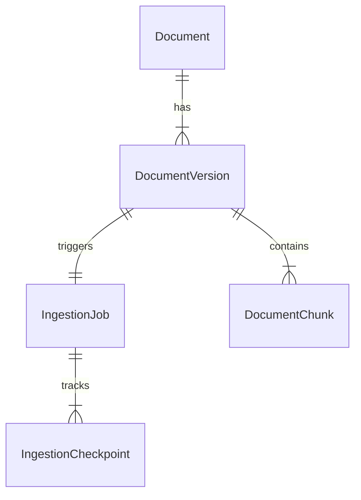
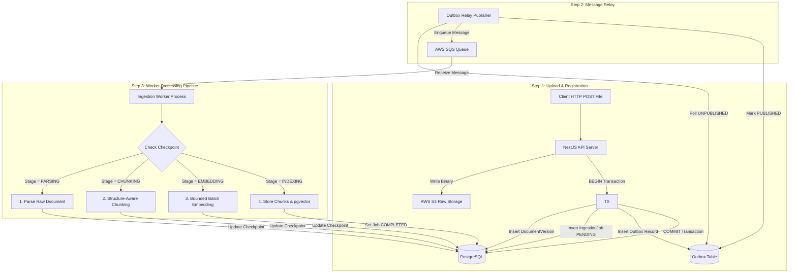

# Architecture: Ingestion Pipeline

## Purpose

The Ingestion Pipeline is responsible for asynchronously transforming raw uploaded documents into parsed, chunked, and embedded vectors ready for similarity search.

---

## Architectural Distinctions

To ensure system reliability, three distinct mechanisms are utilized for clear, non-overlapping responsibilities:

1. **Transactional Outbox Table**: Guarantees **reliable message publication** from PostgreSQL to SQS without dual-write race conditions.
2. **SQS Queue**: Handles **decoupled message delivery** between the API server and worker instances with backpressure and visibility timeouts.
3. **IngestionJob Checkpoints**: Track **processing progress** inside the database, enabling workers to resume failed jobs from the exact last successful stage without duplicating prior work.

---

## Document, Version, and Job Relationships

Each physical file uploaded creates a logical `Document` record. Updates create a new `DocumentVersion`. Each `DocumentVersion` initiates a dedicated `IngestionJob`.

---

## Data Flow Pipeline

---

## Processing Stage Details

1. **`PENDING`**: Job created in database, waiting for worker consumption from SQS.
2. **`PARSING`**: Worker fetches raw binary from S3, parses plain text, headings, and code blocks.
3. **`CHUNKING`**: Worker splits parsed text into token-bounded sections preserving heading context and overlap.
4. **`EMBEDDING`**: Worker sends text chunks in bounded batches to the Embedding Provider interface.
5. **`INDEXING`**: Worker writes chunks and vector arrays into `DocumentChunk` tables in PostgreSQL using `pgvector`.
6. **`COMPLETED`**: All chunks are committed, vector indexes updated, and job marked finished.

---

## Idempotency & Failure Recovery

- **Deterministic Chunk ID Generation**: Chunk IDs are derived deterministically from `(version_id, chunk_index)`. Re-running the `INDEXING` stage overwrites or ignores existing identical chunks rather than duplicating them.
- **Stage Checkpoint Invariants**: Workers verify `IngestionJob.checkpoint` before executing a stage. If a worker crashes mid-stage, the replacement worker resumes at the recorded checkpoint.
- **SQS Visibility Timeout**: If a worker fails to acknowledge a task within the SQS Visibility Timeout (e.g., due to process crash), SQS makes the message visible again for another worker.
- **Dead-Letter Queue (DLQ)**: Tasks failing continuously up to `maxReceiveCount` (e.g., due to corrupt PDF binaries) are moved to the SQS DLQ for manual inspection, marking the `IngestionJob` as `FAILED`.

---

## Open Questions

- What is the optimal SQS Visibility Timeout setting relative to heavy PDF parsing times?
- Should deleted document chunks be purged synchronously during version deletion or via background worker?

---

## Related Documentation

- [[overview]]
- [[reliability]]
- [[../domain/ingestion-jobs]]
- [[../domain/chunking]]
- [[../decisions/ADR-003-transactional-outbox]]
- [[../infrastructure/messaging]]
