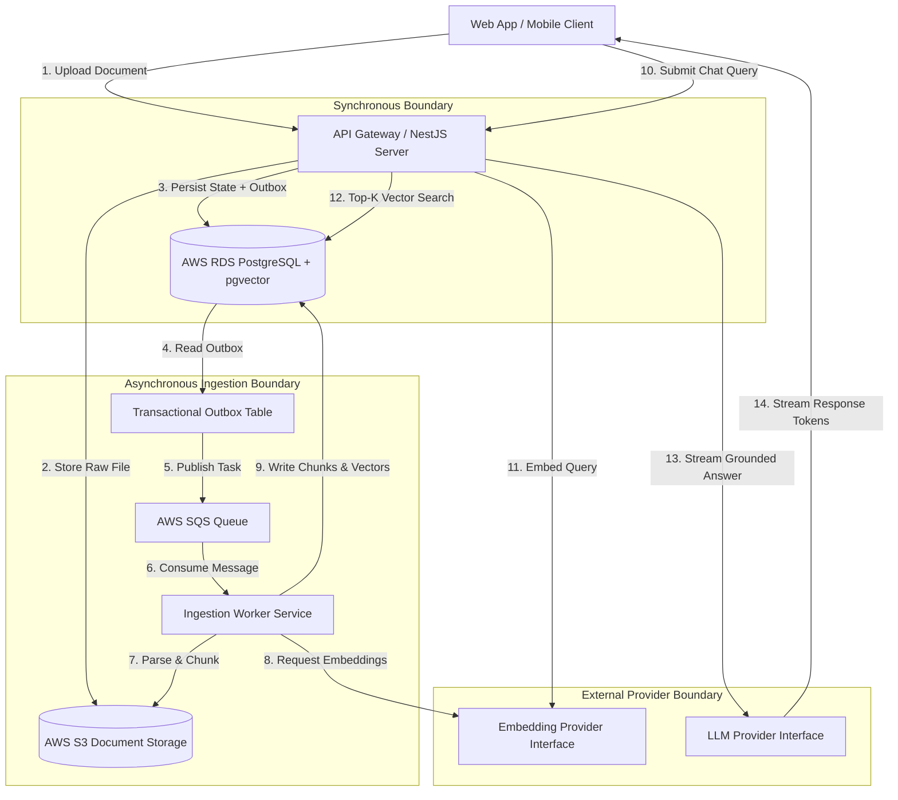

# Architecture Overview

## Purpose

This document provides a high-level architectural map of the Knowledge Engine system, detailing component responsibilities, data flow boundaries, and operational guarantees across the system lifecycle.

---

## High-Level System Context

Knowledge Engine separates concerns into synchronous client-facing APIs (upload, conversation) and asynchronous background processing pipelines (parsing, chunking, embedding, vector indexing).

---

## Major Components

### 1. API Gateway / App Server (`apps/backend`)
- Built with **NestJS**.
- Exposes RESTful / WebSockets endpoints for document upload, ingestion job status tracking, and interactive chat.
- Manages user sessions, authentication, document metadata registration, and conversation history.
- Handles synchronous retrieval and context assembly for AI chat generation.

### 2. Primary Database & Vector Store (`PostgreSQL + pgvector`)
- Actively serves as the single source of truth for application domain state.
- Stores relational metadata for Documents, DocumentVersions, IngestionJobs, OutboxMessages, Conversations, and Messages.
- Uses `pgvector` for dense vector storage and similarity search over document chunks.

### 3. Object Storage (`AWS S3`)
- Stores raw, immutable uploaded document files (PDFs, Markdown, raw texts).
- Stores large intermediate parsed output structures if needed.

### 4. Reliable Messaging (`Transactional Outbox + AWS SQS`)
- **Outbox Table**: Ensures database updates and message enqueue actions occur inside atomic relational transactions.
- **SQS Queue**: Distributes work items to worker processes with at-least-once delivery guarantees and dead-letter queues (DLQ).

### 5. Ingestion Worker Service (`Worker Component`)
- Decoupled background service that polls SQS for ingestion tasks.
- Manages ingestion stage progression (`PARSING` → `CHUNKING` → `EMBEDDING` → `INDEXING` → `COMPLETED`).
- Manages stage progress via granular job checkpoints in PostgreSQL.

### 6. AI Model Provider Abstractions
- **Embedding Service Boundary**: Standardized interface for generating dense embeddings (self-hosted model initially).
- **LLM Service Boundary**: Standardized interface for streaming generative completions (local model via Ollama initially).

---

## System Flow Boundaries

| Boundary | Type | Key Responsibility | Failure Strategy |
| :--- | :--- | :--- | :--- |
| **API → PostgreSQL** | Synchronous | Document metadata & conversation recording | Immediate HTTP error response |
| **API → S3** | Synchronous | Raw document binary write | Rejection of upload transaction |
| **PostgreSQL → SQS (Outbox)** | Asynchronous | Reliable event dispatch | Outbox polling retry loop |
| **SQS → Ingestion Worker** | Asynchronous | Document parsing, chunking, & vector indexing | SQS visibility timeout & retries to DLQ |
| **Worker → Model Interface** | Asynchronous | Dense embedding generation | Bounded batch retries & stage checkpoints |
| **API → LLM Interface** | Synchronous (Stream) | Grounded chat completion streaming | Fallback error token stream |

---

## Key Invariants

1. **Relational Source of Truth**: PostgreSQL is authoritative. S3 and vector indexes augment PostgreSQL state but do not replace it.
2. **Synchronous vs. Asynchronous Separation**: Heavy tasks (file parsing, embedding generation) must never execute synchronously within HTTP request cycles.
3. **Provider Isolation**: Application domain code must consume LLM and Embedding interfaces, never vendor-specific SDK classes directly.

---

## Related Documentation

- [[ingestion]]
- [[retrieval]]
- [[chat]]
- [[reliability]]
- [[../decisions/ADR-001-postgresql-pgvector]]
- [[../infrastructure/aws]]
