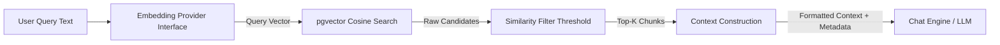

# Architecture: Retrieval Pipeline

## Purpose

The Retrieval Pipeline converts user natural language queries into dense vector representations, searches PostgreSQL via `pgvector` for semantically relevant document chunks, and constructs a grounded evidence context for generative AI completion.

---

## Retrieval Data Flow



---

## Core Steps

### 1. Query Vector Embedding
The incoming natural language query is passed to the **Embedding Provider Interface**. The exact same embedding model used during document ingestion must be used for query embedding to ensure vector space alignment.

### 2. pgvector Vector Search
The system queries PostgreSQL using `pgvector` operators (e.g., `<=>` for cosine distance or `<->` for L2 distance) over indexed chunk vectors:
```sql
SELECT id, document_id, version_id, content, metadata, 1 - (embedding <=> $1) AS similarity
FROM document_chunks
WHERE 1 - (embedding <=> $1) >= $similarity_threshold
ORDER BY similarity DESC
LIMIT $top_k;
```

### 3. Top-$K$ Selection & Similarity Thresholding
- **Top-$K$ Selection**: Limits maximum retrieved passages (e.g., $K=5$) to prevent context window overflow.
- **Similarity Threshold**: Filters out candidate chunks whose similarity score falls below a minimum threshold. If no chunks exceed the threshold, the result set is empty.

### 4. Insufficient Evidence Detection
If vector search yields zero chunks (or all candidates fall below the similarity threshold), retrieval fails early. The system bypasses generative completion and directly returns an explicit **insufficient evidence message**:

> *"I am unable to answer your question because the relevant internal documentation could not be found."*

This prevents model hallucinations and ensures strict adherence to company knowledge.

### 5. Context Construction & Citation Metadata
Retrieved chunks above the similarity threshold are assembled into an immutable evidence block provided to the LLM system prompt. Each chunk is tagged with explicit citation identifiers:
```text
[Source 1]: Document: "Security Guidelines v2", Chunk: 4
Content: "All database credentials must be fetched from AWS Secrets Manager."
```

---

## Advanced Retrieval Features (Future Extensions)

To preserve initial architectural simplicity, the following techniques are explicitly deferred and documented as future extensions:
- **Multi-Stage Reranking**: Cross-encoder / Cohere reranking models.
- **Hybrid Search**: Reciprocal Rank Fusion (RRF) combining sparse BM25 and dense vector search.
- **Query Rewriting / Expansion**: LLM-driven hypothetical document embeddings (HyDE) or query sub-segmentation.

These will only be introduced when formal evaluation metrics indicate that standard dense vector retrieval is insufficient.

---

## Open Questions

- What default numerical value should be set for the similarity threshold?
- What maximum token capacity should be reserved for retrieved context in the prompt assembly?

---

## Related Documentation

- [[overview]]
- [[chat]]
- [[../domain/embeddings]]
- [[../infrastructure/database]]
- [[../decisions/ADR-001-postgresql-pgvector]]
