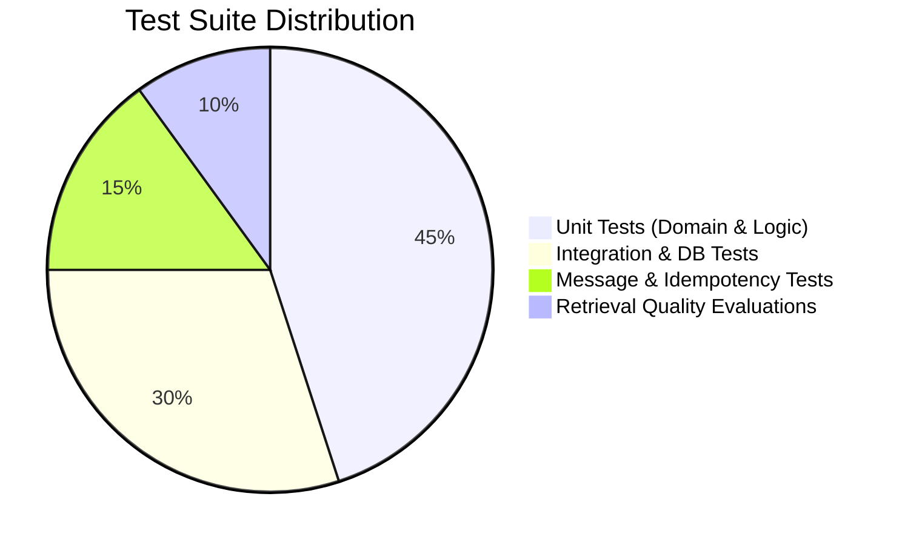

# Development: Testing Strategy

## Purpose

This document outlines the multi-tiered testing strategy for Knowledge Engine, covering unit tests, integration tests, database tests, message processing idempotency tests, and retrieval quality evaluations.

---

## Testing Pyramid & Taxonomy



---

## Test Categories

### 1. Unit Tests (`*.spec.ts`)
- **Scope**: Isolated testing of domain entities, chunking strategies, text parsing algorithms, and prompt formatters.
- **Rules**: Zero network calls, zero database connections. Fast execution (< 5 seconds for full suite).

### 2. Database & Repository Tests
- **Scope**: Validates PostgreSQL migrations, `pgvector` similarity queries, HNSW index operations, and Transactional Outbox atomic writes.
- **Environment**: Runs against a real PostgreSQL + `pgvector` container (via Docker / Testcontainers).

### 3. Messaging & Ingestion Integration Tests
- **Scope**: Exercises the end-to-end ingestion pipeline (`Upload` → `Outbox` → `SQS` → `Worker` → `Indexing`).
- **Focus**: Validates stage checkpoint progression (`PARSING` → `CHUNKING` → `EMBEDDING` → `INDEXING` → `COMPLETED`).

### 4. Idempotency & Failure Injection Tests
- **Scope**: Explicitly tests system resiliency under failure modes:
  - **Duplicate Message Re-delivery**: Delivers the same SQS task twice and asserts no duplicate `DocumentChunk` records or corrupted indices are created.
  - **Worker Crash Simulation**: Simulates worker container crash mid-embedding stage and asserts replacement worker resumes cleanly from database checkpoint.
  - **Poison-Pill Payloads**: Feeds corrupt PDF binaries and asserts message is moved to DLQ after max retries while marking `IngestionJob` as `FAILED`.

### 5. Retrieval Quality Evaluations (RAG Benchmarks)
- **Scope**: Evaluates vector search relevance, hit rates, and grounding fidelity against a curated dataset of reference documents and query-answer ground truth pairs.
- **Metrics**:
  - **Hit Rate @ K**: Frequency of correct source passage appearing in top-$K$ search results.
  - **Grounding Rate**: Percentage of generated answers strictly supported by retrieved context without hallucination.
  - **Insufficient Evidence Recall**: Verifies that out-of-domain queries trigger the insufficient evidence response 100% of the time.

---

## Test Commands

```bash
# Run unit tests
pnpm --filter backend test

# Run database & integration tests
pnpm --filter backend test:e2e

# Run test coverage report
pnpm --filter backend test:cov
```

---

## Related Documentation

- [[coding-conventions]]
- [[implementation-plan]]
- [[../architecture/reliability]]
