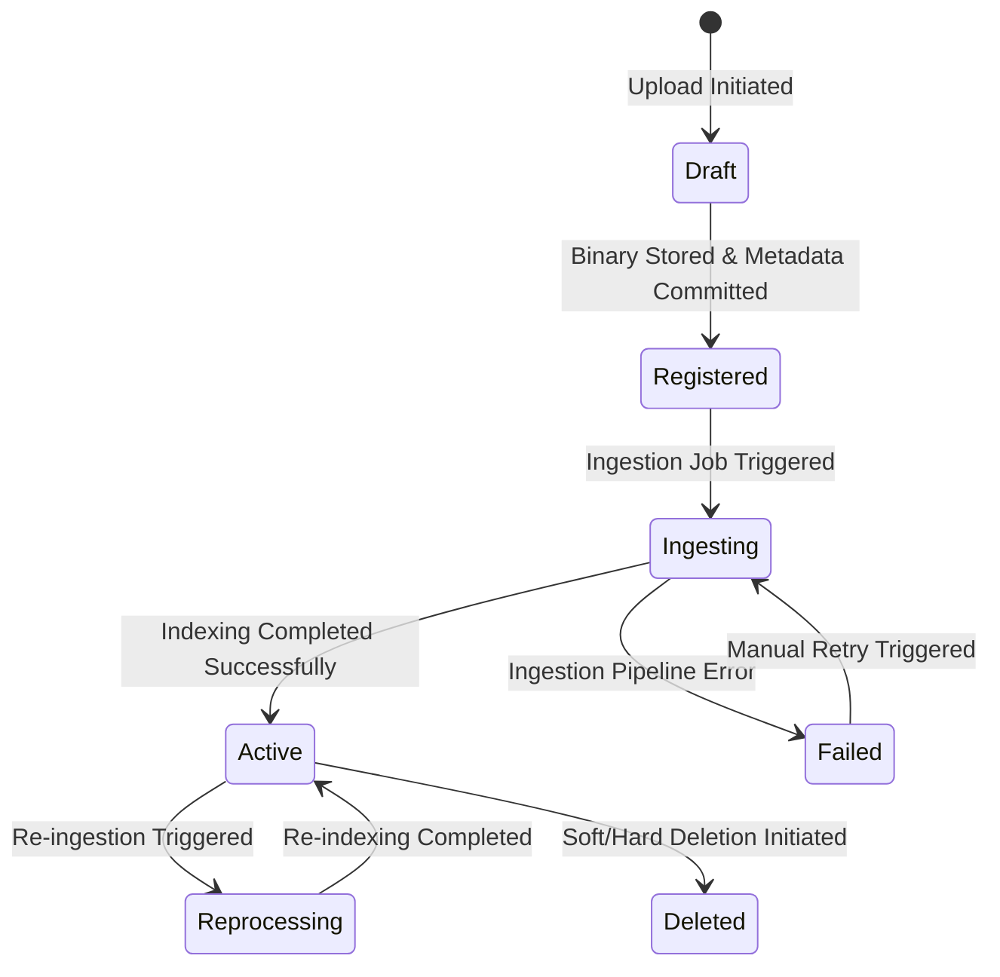

# Domain: Documents & Versions

## Purpose

This document defines the domain concepts, entities, lifecycles, and invariants governing documents and document versions in Knowledge Engine.

---

## Domain Entities

### Document
The root aggregate representing a logical document within the system.

- **Attributes**: `id`, `title`, `source_type`, `created_at`, `updated_at`.
- **Responsibilities**: Serves as the stable parent identity for multiple document versions over time.

### DocumentVersion
A specific immutable snapshot of a Document's file content.

- **Attributes**: `id`, `document_id`, `version_number`, `s3_object_key`, `file_hash`, `file_size_bytes`, `created_at`.
- **Responsibilities**: Represents a single immutable file state that triggers an ingestion job.

---

## Document Lifecycle

---

## Key Invariants

1. **Version Immutability**: Once a `DocumentVersion` is committed to persistent storage, its binary content and file hash cannot be modified. Any content update must create a new `DocumentVersion` with an incremented `version_number`.
2. **Parent-Child Integrity**: A `DocumentVersion` cannot exist without a parent `Document`.
3. **Active Version Selection**: Retrieval search queries evaluate chunks against the latest `Active` version of a document unless an explicit historic version target is specified.
4. **Deterministic Version Hashing**: Uploading an identical binary file hash under the same parent `Document` must be detected to avoid redundant processing.

---

## Reprocessing & Deletion Domain Behaviors

- **Reprocessing**: Triggering reprocessing on a document version generates a new `IngestionJob` and replaces existing vector chunks for that specific `version_id`.
- **Deletion**: Marking a document deleted cascades deletion flags down to associated `DocumentVersion` and `DocumentChunk` records.

---

## Open Questions

- Should document deletion perform an immediate hard delete of vector chunks or mark them for asynchronous background cleanup?

---

## Related Documentation

- [[ingestion-jobs]]
- [[chunking]]
- [[../architecture/ingestion]]
- [[../infrastructure/database]]
