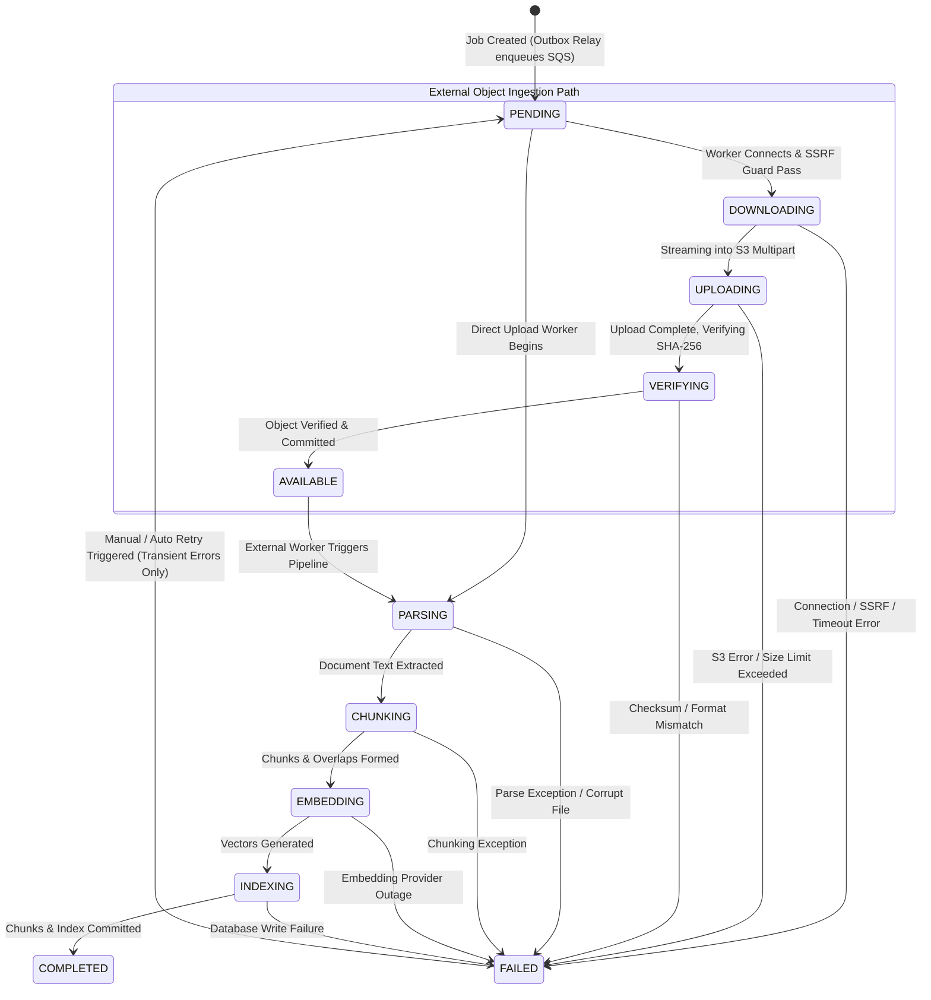

# Domain: Ingestion Jobs

## Purpose

This document specifies the domain lifecycle, state machine transitions, checkpoints, and stage invariants for `IngestionJob` entities.

---

## IngestionJob State Machine

An `IngestionJob` models the lifecycle of processing a single `DocumentVersion`. Transitions between states are monotonic and explicitly checkpointed.

For direct client uploads, jobs transition directly from `PENDING` to `PARSING`. For **external object imports** (URLs or S3 presigned URLs), jobs execute pre-processing acquisition stages (`DOWNLOADING` → `UPLOADING` → `VERIFYING` → `AVAILABLE`) before entering `PARSING`.

---

## Stage Descriptions & Invariants

### 1. External Ingestion Stages (External URL / Presigned URL Sources)
- **`DOWNLOADING`**: Worker has resolved DNS, verified SSRF guards, established socket, and initiated streaming read.
- **`UPLOADING`**: Worker is streaming bytes through bounded memory buffers (8–16 MB) directly into destination S3 multipart upload. Enforces hard byte count against `MAX_OBJECT_SIZE`.
- **`VERIFYING`**: Multipart upload completed; worker verifies calculated streaming SHA-256 checksum and inspects initial 512 bytes for valid magic byte file signature.
- **`AVAILABLE`**: Object is durably stored, verified in S3, and unlocked for downstream consumption. Incomplete objects never reach `AVAILABLE`.

### 2. Standard Processing Stages
- **`PENDING`**: Job record exists in database with `stage = PENDING`. SQS task has been enqueued via Transactional Outbox.
- **`PARSING`**: Worker has loaded raw document binary from object storage. Extracted plain text must not be empty.
- **`CHUNKING`**: Output chunks must strictly respect max token boundaries and maintain sequential chunk indexing (`chunk_index = 0, 1, 2...`).
- **`EMBEDDING`**: Every chunk emitted by the chunking stage must receive a dense vector embedding from a single unified embedding model.
- **`INDEXING`**: Chunks and vector embeddings must be transactionally committed to database vector tables.
- **`COMPLETED`**: All chunks are searchable; `IngestionJob.completed_at` timestamp is set.

---

## Failure & Retry Rules

- **Transient Failures**: Failures during `DOWNLOADING`, `UPLOADING`, `EMBEDDING`, or `INDEXING` due to temporary network timeouts trigger worker retries with exponential backoff and jitter. Processing resumes at the last successful checkpoint stage.
- **Terminal Failures**: Malformed binary files, SSRF violations, expired presigned URLs (`SOURCE_AUTH_EXPIRED`), or objects exceeding size limits move the job to `FAILED` state, abort incomplete multipart uploads, and log an error payload to `IngestionJob.error_details`. Never retry expired capabilities or permanent authorization errors.

---

## Open Questions

- What maximum execution duration should be enforced before considering a stage execution timed out?
- Should external object acquisition and downstream parsing be executed by separate SQS queues and worker task definitions?

---

## Related Documentation

- [[documents]]
- [[chunking]]
- [[embeddings]]
- [[../architecture/ingestion]] — Authoritative ingestion pipeline and external streaming architecture.
- [[../decisions/ADR-006-external-object-streaming-ingestion]] — External object streaming decision record.
