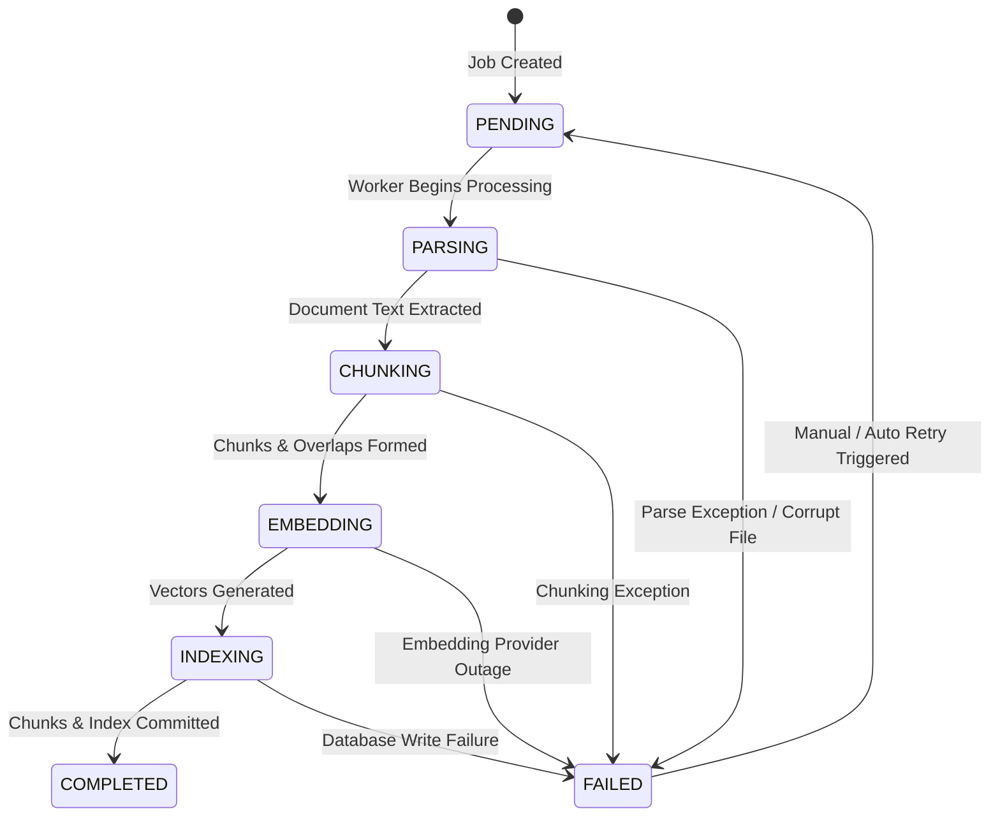

# Domain: Ingestion Jobs

## Purpose

This document specifies the domain lifecycle, state machine transitions, checkpoints, and stage invariants for `IngestionJob` entities.

---

## IngestionJob State Machine

An `IngestionJob` models the lifecycle of processing a single `DocumentVersion`. Transitions between states are monotonic and explicitly checkpointed.

---

## Stage Descriptions & Invariants

### 1. `PENDING`
- **Invariant**: Job record exists in database with `stage = PENDING`. SQS task has been enqueued via Transactional Outbox.

### 2. `PARSING`
- **Invariant**: Worker has loaded raw document binary from object storage. Extracted plain text must not be empty.

### 3. `CHUNKING`
- **Invariant**: Output chunks must strictly respect max token boundaries and maintain sequential chunk indexing (`chunk_index = 0, 1, 2...`).

### 4. `EMBEDDING`
- **Invariant**: Every chunk emitted by the chunking stage must receive a dense vector embedding from a single unified embedding model.

### 5. `INDEXING`
- **Invariant**: Chunks and vector embeddings must be transactionally committed to database vector tables.

### 6. `COMPLETED`
- **Invariant**: All chunks are searchable; `IngestionJob.completed_at` timestamp is set.

---

## Failure & Retry Rules

- **Transient Failures**: Failures during `EMBEDDING` or `INDEXING` due to temporary network timeouts trigger worker retries. Processing resumes at the last successful checkpoint stage.
- **Terminal Failures**: Malformed binary files or unparseable formats move the job to `FAILED` state and log an error payload to `IngestionJob.error_details`.

---

## Open Questions

- What maximum execution duration should be enforced before considering a stage execution timed out?

---

## Related Documentation

- [[documents]]
- [[chunking]]
- [[embeddings]]
- [[../architecture/ingestion]]
