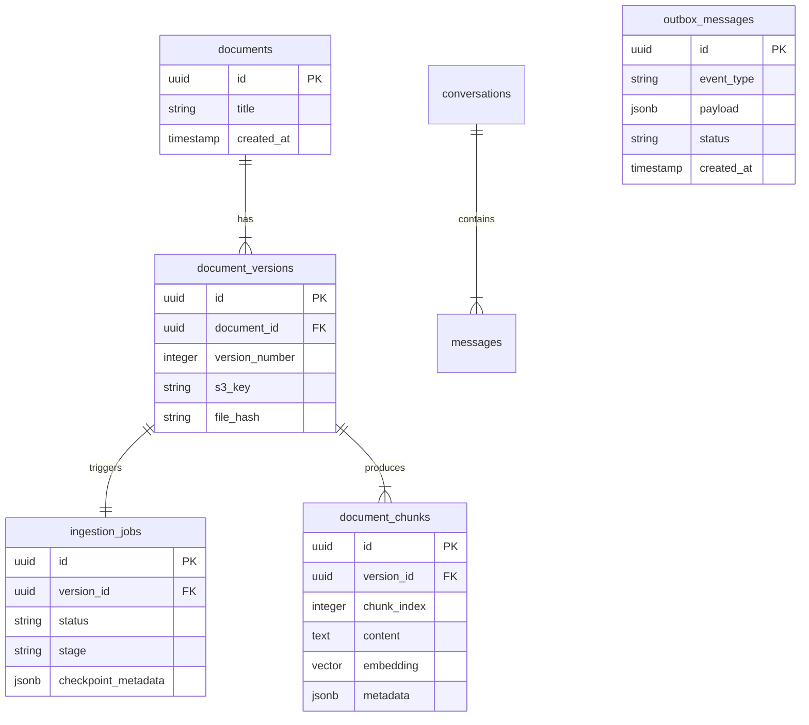

# Infrastructure: Database (`PostgreSQL + pgvector`)

## Purpose

This document outlines the PostgreSQL database architecture, relational domain tables, `pgvector` indexing strategies, transaction boundaries, and schema management conventions.

---

## Database Ownership & Role

PostgreSQL serves as the **single authoritative source of truth** for all persistent relational data, transactional outbox messages, and vector embeddings in Knowledge Engine.

---

## Core Domain Schema Table Layout



---

## `pgvector` Vector Store Indexing

The `document_chunks.embedding` column utilizes the `pgvector` extension to enable vector similarity queries:

- **Vector Column**: `vector(DIMENSIONS)` (exact dimensions defined by embedding model choice).
- **Index Types**:
  - **HNSW (Hierarchical Navigable Small World)** or **IVFFlat**: Used for approximate nearest neighbor (ANN) search across large chunk volumes.
  - **Distance Metric**: Cosine Distance (`<=>`) or L2 Distance (`<->`).

```sql
-- Example HNSW vector index construction
CREATE INDEX ON document_chunks 
USING hnsw (embedding vector_cosine_ops)
WITH (m = 16, ef_construction = 64);
```

---

## Transaction Boundaries & Outbox Pattern

1. **Document Upload Transaction**:
   - `INSERT INTO documents ...`
   - `INSERT INTO document_versions ...`
   - `INSERT INTO ingestion_jobs ...`
   - `INSERT INTO outbox_messages ...` (atomic transaction).
2. **Chunk Vector Commit Transaction**:
   - `INSERT INTO document_chunks (id, version_id, chunk_index, content, embedding) ...` (batch insert using `UPSERT`).
   - `UPDATE ingestion_jobs SET stage = 'COMPLETED' ...`

---

## Future Schema Migration Considerations

- **Prisma / TypeORM / Kysely**: Database migrations must be managed via explicit versioned SQL migration scripts.
- **pgvector Extension Upgrades**: Extensions must be enabled via `CREATE EXTENSION IF NOT EXISTS vector;`.

---

## Open Questions

- What specific vector index parameters (`m`, `ef_construction`) provide optimal query performance at target chunk scales?

---

## Related Documentation

- [[aws]]
- [[messaging]]
- [[../domain/documents]]
- [[../decisions/ADR-001-postgresql-pgvector]]
