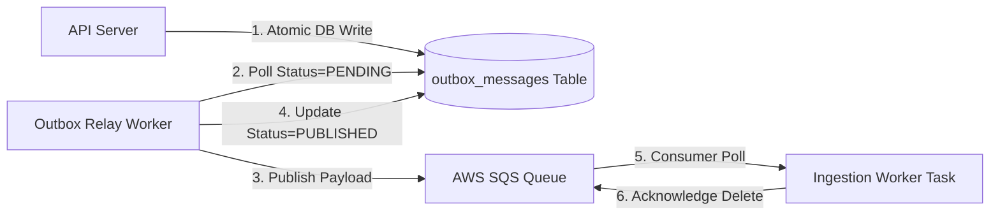

# Infrastructure: Messaging & Queuing

## Purpose

This document specifies the messaging semantics, AWS SQS queue configurations, Transactional Outbox relay mechanics, message payload contracts, and error handling policies.

---

## Messaging Semantics vs. Domain Processing State

> [!IMPORTANT]
> **Semantic Distinction**:
> - **SQS Message Delivery**: Guarantees that a message transport payload reaches a worker task (**at-least-once transport**).
> - **IngestionJob Checkpoint**: Tracks business logic processing progress (**domain state** inside PostgreSQL).

Messaging semantics ensure delivery; checkpoint state ensures safe, idempotent execution.

---

## Outbox Message Lifecycle



---

## SQS Queue Configurations

1. **Standard Ingestion Queue (`knowledge-engine-ingestion-queue`)**:
   - **Delivery Guarantee**: At-least-once.
   - **Message Retention Period**: 4 days.
   - **Visibility Timeout**: Configured to exceed expected single-stage worker processing duration (e.g., 5 minutes).
   - **Redrive Policy**: Directs failed messages to DLQ after `maxReceiveCount` (e.g., 5 attempts).

2. **Dead-Letter Queue (`knowledge-engine-ingestion-dlq`)**:
   - Stores unprocessable poison-pill messages for operational investigation.

---

## Message Payload Contract

All outbox and SQS messages adhere to a standardized JSON schema:

```json
{
  "eventId": "123e4567-e89b-12d3-a456-426614174000",
  "eventType": "ingestion.job.created",
  "timestamp": "2026-09-12T10:00:00Z",
  "traceId": "trace-abc-789",
  "payload": {
    "jobId": "98765432-b12c-34d5-e678-901234567890",
    "documentId": "doc-111",
    "versionId": "ver-222",
    "s3Key": "tenants/ten_default/documents/doc-111/versions/ver-222/raw.bin"
  }
}
```

For external object ingestion jobs, the payload conveys the source access model and redacted URL reference:

```json
{
  "eventId": "234e5678-e89b-12d3-a456-426614174001",
  "eventType": "ingestion.external_object.import",
  "timestamp": "2026-09-14T17:00:00Z",
  "traceId": "trace-xyz-123",
  "payload": {
    "jobId": "87654321-c23d-45e6-f789-012345678901",
    "documentId": "doc-222",
    "versionId": "ver-333",
    "sourceType": "external_url",
    "sourceUrl": "https://external-bucket.s3.amazonaws.com/files/report.pdf?AWSAccessKeyId=...",
    "destinationS3Key": "tenants/ten_default/documents/doc-222/versions/ver-333/raw.bin",
    "maxSizeBytes": 524288000,
    "expectedChecksumSha256": "e3b0c44298fc1c149afbf4c8996fb92427ae41e4649b934ca495991b7852b855"
  }
}
```

---

## Idempotency Contracts

Workers receiving SQS messages must execute idempotently:

- Consumers extract `eventId` and `versionId` from the payload.
- Before executing work, the consumer inspects `IngestionJob.stage` in PostgreSQL. If the job is already `COMPLETED` or beyond the target stage, the worker logs a duplicate notice and acknowledges (deletes) the SQS message immediately.
- For external stream jobs, workers use atomic SQL updates (`UPDATE ingestion_jobs SET stage = 'DOWNLOADING' WHERE id = :jobId AND stage = 'PENDING'`) to claim exclusive processing rights.

---

## Open Questions

- What specific polling frequency and batch size (`MaxNumberOfMessages`) should be configured for the outbox relay process?
- Should external object acquisition tasks run on a separate SQS queue from parsing/embedding tasks?

---

## Related Documentation

- [[aws]]
- [[database]]
- [[../architecture/ingestion]] — Authoritative ingestion pipeline and external streaming architecture.
- [[../decisions/ADR-002-sqs-over-kinesis]]
- [[../decisions/ADR-003-transactional-outbox]]
- [[../decisions/ADR-006-external-object-streaming-ingestion]] — External object streaming and S3 multipart lifecycle.
